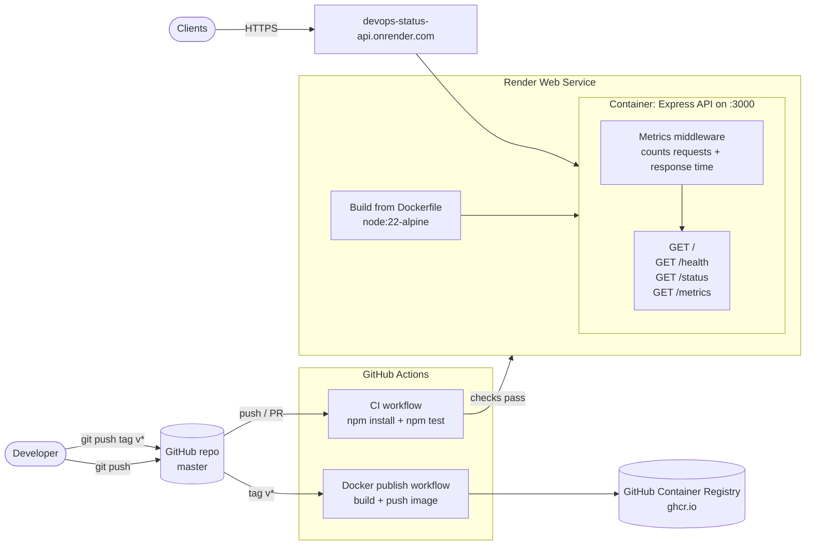

# Docker, GitHub Actions, and Render

**Project Link:** [View Project](https://nextwork.ai/projects/4f702b3c-ba34-4b57-adf2-3ccd350d3cda)

**Author:** Robel Yonas  
**Email:** robel4872@gmail.com

---

## Project Overview: Building a Professional DevOps Pipeline

### Goals and purpose

In this project, I’m building a containerized Node.js/Express REST API and a full CI/CD pipeline around it. I’ll package the app with Docker, use GitHub Actions to run automated tests on every push, and deploy it to Render. Render will only go live with a new version once the CI checks pass, so every change is tested before it reaches production.

### System design

| Endpoint | Returns |
| --- | --- |
| [`/`](https://devops-status-api.onrender.com/) | Welcome message |
| [`/health`](https://devops-status-api.onrender.com/health) | `{ "status": "healthy" }` |
| [`/status`](https://devops-status-api.onrender.com/status) | Version (from `package.json`), uptime, timestamp |
| [`/metrics`](https://devops-status-api.onrender.com/metrics) | Total requests, average response time, uptime |

## Deploying a Live API with Automated CI/CD

### Deployment strategy

In this step, I'm deploying my app to Render so that I can have it live on a public URL that anyone can reach. I'm connecting my GitHub repository to Render and creating a Web Service that builds the app from my Dockerfile. I'm also setting Auto-Deploy to "After CI Checks Pass," so Render only deploys a new version once my GitHub Actions tests pass. Finally, I'm testing the full pipeline by bumping the version to 1.0.1, pushing the change, and checking that the tests run, Render deploys it, and the live /status endpoint shows the new version.

## Automating Tests with GitHub Actions

### CI pipeline setup

In this step, I'm setting up GitHub Actions so that I can automatically run my tests every time I push code. I'm creating a workflow file that tells GitHub to spin up a fresh machine, install the dependencies and run npm test on every push to main. Then I'm pushing the project to a public GitHub repository and checking that the tests pass in the Actions tab. Finally, I'm intentionally breaking a test to make sure the pipeline catches the failure, so broken code can't sneak through to production.

## Containerizing the API with Docker

### Containerization approach

In this step, I’m containerizing the application I’ve built so that it runs the same way, without issues, on different devices, so I don’t get the “it only works on my device” issue. I’m writing a Dockerfile, which is a set of instructions that tells Docker what tools, files and dependencies the application needs and what command to run to start it. Docker follows these instructions to build an image, which is the packaged version of the application. When you run the image, it creates a container, which is the running version of the image. I’m also adding a .dockerignore, which works like .gitignore and tells Docker what not to include when packaging the application, like node_modules and the .git folder. Finally, I’ll run the container and visit /health to check that the API responds the same way it did locally.

### Why Docker matters

You already said most of this in your last answer, so here's a version built from your own wording, following the template:

> Docker gives me a consistent environment that packages the app together with its dependencies and the right Node.js version, which means I can run it the same way on any device or server without the "it only works on my device" issue. With node index.js, the app depends on whatever is installed on that specific machine, so it could break on someone else's computer or in the cloud.

## Building the REST API

### API design and implementation

In this step, I’m building the Express application with simple endpoints that return JSON responses: a root route that confirms the API is reachable, a /health endpoint that returns a healthy status, and a /status endpoint that reports the version, uptime and timestamp. These responses are what I evaluate during the testing phase. I also changed the default npm test script to a custom one that runs test.js, and wrote automated tests that check the /health and /status endpoints return the right data. The reason I’m automating the tests is that they’ll be used in the CI/CD pipeline, which is the goal of the project.

## Setting Up the Project Environment

### Tools and configuration

In this step, I’m setting up the tools and dependencies needed for the project. I’m initializing a Node.js project with npm init, which creates a package.json that keeps track of the project and its dependencies. Then I’m installing Express, which will handle the routing and the REST part of the API. I’m also initializing Git with git init so I can save my changes through commits and later push the project to GitHub. Finally, I’m adding a .gitignore to filter out files I don’t want to commit, like the node_modules folder, since it can always be recreated with npm install.

### Managing dependencies with .gitignore

I added node_modules/ to .gitignore because node_modules is the folder where the packages for the project are installed. These are the packages listed in package.json. Other users don’t need the entire node_modules folder, because it’s automatically generated when they run npm install, which downloads the packages from package.json. Committing it would also make the repository much bigger and slower to clone and push, since node_modules can contain thousands of files, even for a small project like this one.

## Secret Mission: Metrics Tracking and Docker Image Publishing

### The /metrics endpoint in action

In this project extension, my /metrics endpoint returns a JSON response with three fields: totalRequests, avgResponseTimeMs, and uptime. totalRequests counts every request the server has received since it started, including the request to /metrics itself, because the middleware runs before every route. avgResponseTimeMs is the total response time divided by the number of requests, showing how fast the API responds on average. uptime shows how many seconds the server has been running and collecting metrics. After hitting the API a few times, I saw totalRequests increase with each request, while the average response time stayed very low because the endpoints are simple.

## Reflections and Key Takeaways

### Tools and concepts learned

The key tools I used include GitHub Actions, Docker, Render, Node.js, and Express. Key concepts I learned include how to create a simple application that I can test and how to use GitHub Actions to automate testing so that whenever I push code, it’s tested before it gets deployed to Render. We set up a rule that all tests must pass before a commit is deployed, ensuring everything works before it goes live. We also used Docker to package the application so it runs the same way on any device, and used Git tags with GitHub Container Registry to publish versioned images, so different people or teams can pull and run a specific version of the application.

### Time and challenges

This project took me approximately 1 hour. The most challenging part was understanding the Docker publish workflow and how it was different from the CI workflow, since at first I thought GitHub Actions was building the image and running the tests together. Once I understood that one workflow tests the code on every push and the other builds and publishes versioned images when I push a tag, the whole pipeline made a lot more sense.

### Looking ahead

I did this project today to learn how to containerize an application with Docker and build a CI/CD pipeline that automatically tests and deploys my code. Another skill I want to learn is Kubernetes, so I can manage and scale containers in production.

---
